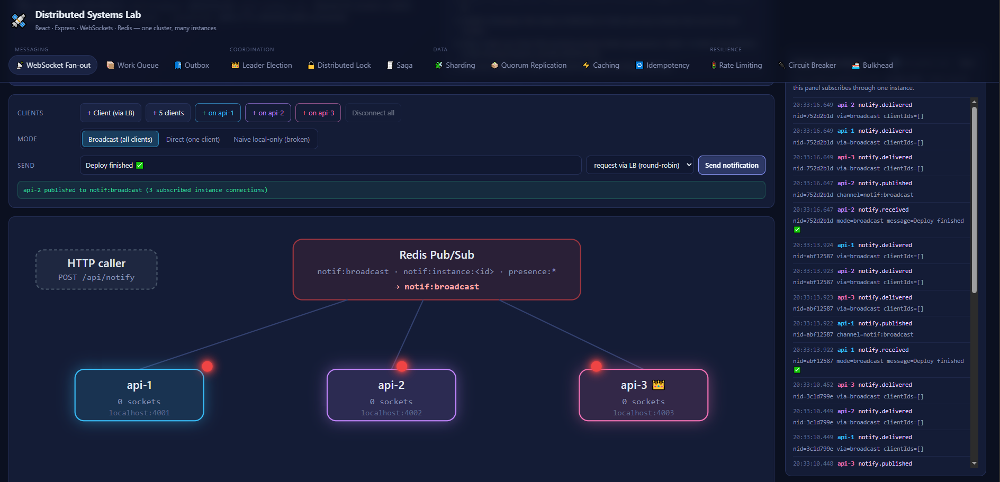
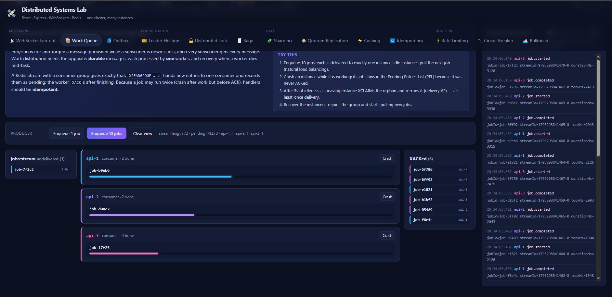
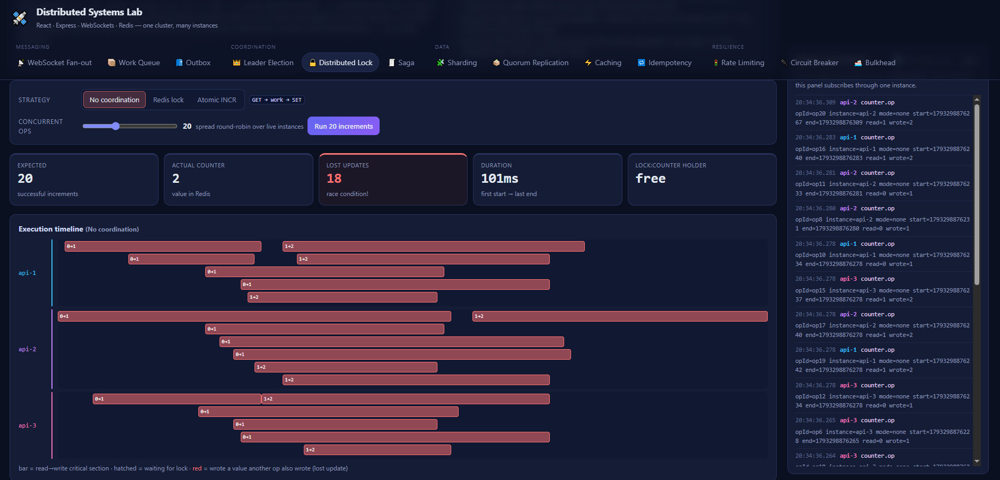
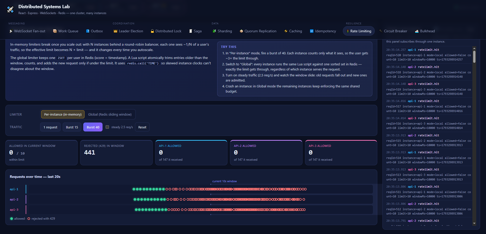
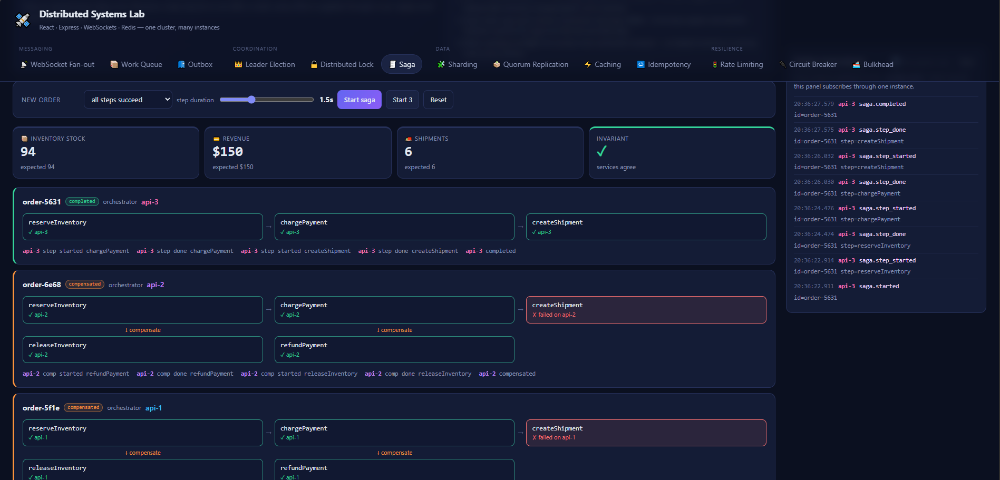
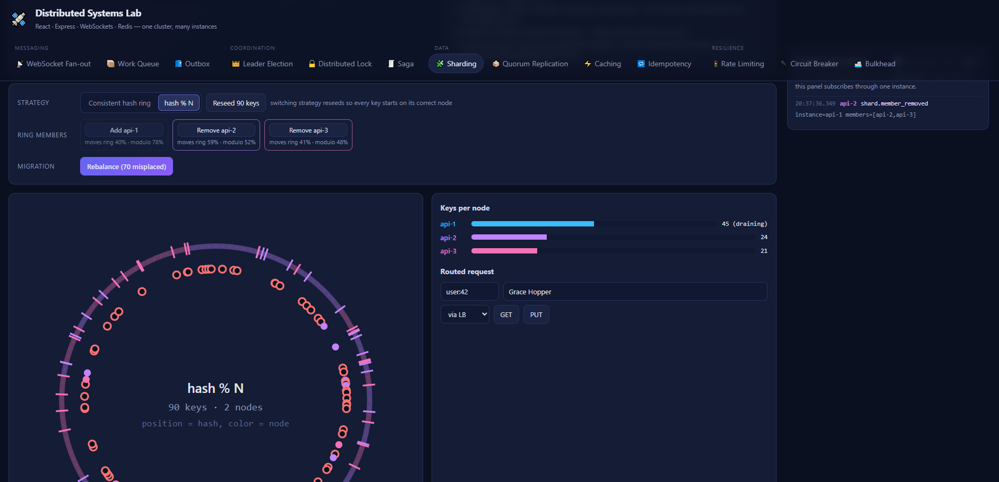

# 🛰️ Distributed Systems Lab

An interactive demo of core distributed-systems patterns. A **React** dashboard visualizes a cluster
of **Node/Express** instances that coordinate through **Redis**. Every pattern is live: you can add
WebSocket clients, fire traffic, and **crash instances** to watch the system recover.

```
                ┌──────────────────────── React dashboard (Vite) ────────────────────────┐
                │  virtual WS clients · pattern visualizations · live cluster event log   │
                └───────┬──────────────────────┬──────────────────────┬──────────────────┘
               HTTP + WS│                      │                      │  (client-side round-robin "LB")
                ┌───────▼──────┐       ┌───────▼──────┐       ┌───────▼──────┐
                │    api-1     │       │    api-2 👑  │       │    api-3     │   Express + ws
                │   :4001      │       │   :4002      │       │   :4003      │
                └───────┬──────┘       └───────┬──────┘       └───────┬──────┘
                        └──────────────┬───────┴──────────────────────┘
                               ┌───────▼────────┐
                               │     Redis      │  pub/sub · keys+TTL · Lua · ZSET · Streams
                               └────────────────┘
```

### Screenshots














## Patterns

Tabs are grouped as **Messaging** (fan-out, work queue, outbox), **Coordination** (leader election, lock, saga),
**Data** (sharding, quorum replication, caching, idempotency) and **Resilience** (rate limiting, circuit breaker, bulkhead).

| Tab | Pattern | Redis primitives | What to try |
| --- | --- | --- | --- |
| 📡 **WebSocket Fan-out** | Multi-instance notifications: broadcast to all clients or route to one client, whichever instance holds its socket | Pub/Sub backplane (`notif:broadcast`, `notif:instance:<id>`), presence registry `presence:<clientId>` with TTL | Compare *naive local-only* vs *broadcast*; click a client and send *direct*; crash an instance and watch its clients reconnect elsewhere |
| 📮 **Outbox** | Dual-write problem vs transactional outbox; relay with failover; at-least-once delivery | `MULTI` (order + outbox row), relay lock `SET NX PX`, Stream as the broker | Crash between DB commit and publish (event lost) or take the broker down; switch to outbox and repeat; crash the relay after publish to get a duplicate |
| 👑 **Leader Election** | Lease-based leader election + fencing tokens | `SET NX PX`, Lua compare-and-`PEXPIRE`, `INCR leader:epoch` | Crash the leader (TTL failover), *Resign* (instant failover), *GC pause* the leader (stale write rejected by fencing token) |
| 🔒 **Distributed Lock** | Lost updates from concurrent read-modify-write across instances | `SET lock <token> NX PX`, Lua compare-and-delete, `INCR` | Run with no lock (lost updates), with a Redis lock (correct, serialized), with atomic `INCR` (correct and fast) |
| 🚦 **Rate Limiting** | Per-instance vs global sliding-window limiter | `ZSET` + Lua script using Redis `TIME` | Burst 40 requests: local mode lets ~3× the limit through; global mode enforces exactly 10/10s |
| 📦 **Work Queue** | Competing consumers with at-least-once delivery | Streams: `XADD`, `XREADGROUP`, `XACK`, `XPENDING`, `XCLAIM` | Enqueue jobs, crash a busy instance: its un-ACKed job is reclaimed by a survivor after 5s |
| 🧾 **Saga** | Orchestrated multi-service transaction with compensations; durable, resumable orchestrator | Saga state hash, per-saga lease (`SET NX PX` + renew), Lua "apply once" effects | Fail a step and watch compensations run in reverse; crash the orchestrator mid-step and watch another instance resume it; check the invariant |
| 🧩 **Sharding** | Partitioned KV store with request forwarding; consistent hash ring (virtual nodes) vs `hash % N` | Per-node partitions `shard:data:<id>`, ring membership set | Remove/add a node and compare how many keys move; rebalance; GET a key through a non-owner and see the forwarding hop |
| 🗳️ **Quorum Replication** | Leaderless N/W/R replication, last-write-wins versions, read repair, anti-entropy | Replicas live in each instance's memory; quorum config hash `quorum:config` | Crash a replica, write, recover it; compare R=W=2 (always fresh) with R=W=1 (stale reads); slow a replica and compare W=1 vs W=3 latency |
| ⚡ **Caching** | Two-level cache-aside (in-process L1 + Redis L2), cross-instance invalidation, stampede protection | Pub/Sub `cache:invalidate`, `SET cache:fill:<id> NX PX` | Update a price without invalidation (stale L1s) vs with Pub/Sub; expire a hot key under 30 concurrent reads with and without the fill lock |
| 🔁 **Idempotency** | Safe retries through a flaky network, across instances | `SET idem:<key> NX`, stored response replay, 409 for in-flight duplicates | Pay with a lost response and no key (double charge) vs with a key (replayed); double-click |
| 🔌 **Circuit Breaker** | Fail fast against a failing dependency: none vs per-instance vs shared breaker | Breaker state hash updated by Lua (using Redis `TIME`) | Set the dependency to 100% failures under traffic and compare latency, fast-fails and load on the dependency |
| 🚢 **Bulkhead** | One shared worker pool vs a pool per dependency; slow dependency starving unrelated requests | Config hash `bulkhead:config`; load generated inside each instance | Degrade recommendations to 3s under load: with one pool, inventory fails too; with bulkheads it stays at 100% |

Cross-cutting pieces:

- **Service discovery / health**: each instance heartbeats `cluster:alive:<id>` (TTL 3s); the topology bar reads it.
- **Observability bus**: every instance publishes what it does to `system:events`; each instance forwards that
  channel to `/ws/monitor`, so the dashboard sees the whole cluster through a single socket.
- **Chaos**: `POST /api/chaos/crash` simulates a process death (stops heartbeats and lease renewal, drops all
  WebSocket clients without a close handshake, abandons in-flight jobs) while keeping the port open so the UI
  can `POST /api/chaos/recover`. You can also kill a real process or container.

## Running it

Requirements: Node 20+ and Docker (only for Redis, or for the whole stack).

### Option A: local dev (hot reload)

```bash
npm run setup
```

```bash
npm run redis
```

```bash
npm run dev
```

This starts Redis in Docker, **3 backend instances** on `:4001–4003` (via `backend/scripts/cluster.js`), and
Vite on http://localhost:5173 (or the next free port).

### Option B: everything in Docker

```bash
docker compose up --build
```

Then open http://localhost:8080. Real failures work too, e.g. `docker compose stop api-2`.

### Ports & configuration

| Variable | Default | Notes |
| --- | --- | --- |
| `REDIS_HOST_PORT` (compose) | `16379` | Host port for Redis. `6379` sits inside a Hyper-V reserved port range on many Windows machines. |
| `WEB_PORT` (compose) | `8080` | Host port for the built dashboard. |
| `REDIS_URL` (backend) | `redis://localhost:16379` | |
| `PORT` / `INSTANCE_ID` / `PUBLIC_URL` (backend) | `4001` / `api-<port>` / `http://localhost:<port>` | `PUBLIC_URL` is what browsers use to reach the instance. |
| `INTERNAL_URL` (backend) | `PUBLIC_URL` | What *other instances* use to reach this one (sharding forwards requests), e.g. `http://api-2:4002` in Docker. |
| `VITE_SEED_URLS` (frontend) | `http://localhost:4001,…:4003` | Instances the dashboard contacts first; it discovers the rest from Redis. |

Run more instances locally with `node backend/scripts/cluster.js 5` (ports 4001–4005).

## Project layout

```
backend/
  src/index.js              Express + WebSocket server wiring, chaos endpoints
  src/registry.js           heartbeats / membership
  src/events.js             system:events bus + /ws/monitor
  src/lifecycle.js          simulated crash state
  src/patterns/
    notifications.js        pub/sub backplane + presence routing
    leaderElection.js       lease, renewal, epochs, fenced resource
    distributedLock.js      none / lock / atomic counter increments
    rateLimiter.js          in-memory vs Redis sliding window
    workQueue.js            Streams consumer group, reclaimer
    saga.js                 orchestrator, compensations, lease-based takeover
    sharding.js             hash ring / modulo routing, forwarding, rebalancing
    caching.js              L1/L2 cache-aside, invalidation, stampede lock
    idempotency.js          Idempotency-Key handling, payment ledger
    circuitBreaker.js       local + Redis-backed breaker, simulated dependency
    outbox.js               dual write vs transactional outbox, relay, fault injection
    quorum.js               in-memory replicas, W/R quorums, read repair, anti-entropy
    bulkhead.js             bounded worker pools, in-process load generator
  scripts/cluster.js        spawns N local instances
frontend/src/
  lib/cluster.jsx           membership polling, monitor socket, round-robin picker
  lib/page.js               usePolling: only the visible page polls
  hooks/useVirtualClients   simulated browser clients with reconnect/failover
  hooks/usePackets.jsx      small rAF engine for animating messages in flight
  patterns/*.jsx            one page per pattern
```

## Notes & caveats (deliberate simplifications)

- The "load balancer" is client-side round-robin so you can see which instance handled each request. In
  production you'd put nginx, an ALB or similar in front, often with sticky sessions for WebSockets.
- A single-node Redis lock is fine for efficiency (avoiding duplicate work) but is not a correctness guarantee
  under failover. Pair locks with fencing tokens (see the Leader Election tab) when correctness matters.
- Redis Pub/Sub is at-most-once: a notification published while an instance is disconnected is lost. For
  guaranteed delivery, persist notifications (e.g. a Stream per user) and let clients catch up on reconnect.
- Streams give at-least-once delivery, so job handlers must be idempotent.
- Sharding: a node's partition lives in Redis, so "rebalancing" can still read a removed node's data. A real
  store would replicate each partition (and the demo's crashed-owner case shows why).
- Outbox: the relay polls the outbox; production systems often use change-data-capture on the DB log instead.
- Quorum replication uses wall-clock last-write-wins, which silently drops one of two concurrent writes. Real
  systems use vector clocks, CRDTs or a consensus protocol, and add hinted handoff for unavailable replicas.
- The saga keeps one orchestrator lease per saga; a production system would add fencing tokens (see Leader
  Election) so a paused orchestrator can't write after losing its lease.
